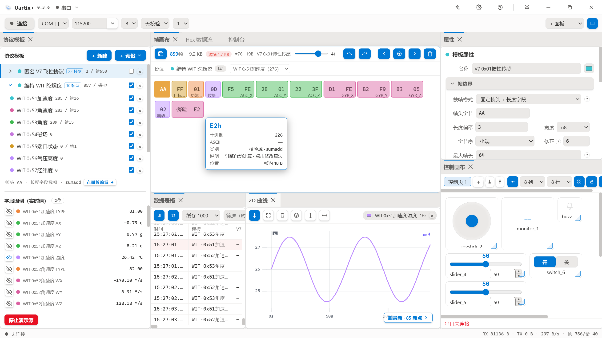

<div align="center">


# Uartix+

### 嵌入式可视化上位机

拖拽定义协议 · 实时解析可视化 · 双向闭环调试

*A visual host-computer suite for embedded systems*

<br/>

[![Release][badge-rel]][get-it]
[![Download][badge-dl]][get-it]
[![License][badge-li]][license]
[![Platform][badge-pf]][get-it]
[![Tauri][badge-ta]][tauri]

<br/>

**[下载安装](#下载)** · **[快速上手](#快速上手)** · **[官网][website]** · **[English](README.en.md)**

</div>



> **v0.6.0 亮点：插件生态进入正式版。** 插件包统一为 v3 目录格式，插件管理并入设置页；新增 GitHub 话题插件市场（带仓库封面与 README 预览）、AI 插件草稿与预览、装前权限批准卡、插件运行日志与操作账本；YOLO 训练工作台补齐训练完成时间、部署页与保存/发布链路。

---

## 它是什么

Uartix+ 是一台跑在电脑上的**上位机**。向下连接单片机、惯导、云台、机器人这些下位机，向上把一串串看不懂的原始字节变成结构、数值、曲线和画面，再把你的操作回写成设备能够接受的指令。

它不是只会收发字符的串口助手：**协议无需编写解析代码**，在数据流上框选字节即可定义帧结构与字段含义；**界面无需编写界面代码**，拖拽控件就能拼出专属调试台。连接、校验、测量、可视化、脚本自动化与数据导出，在同一处完成闭环。

| | 传统串口助手 | 波形工具 | **Uartix+** |
|---|:---:|:---:|:---:|
| 收发原始数据 | ✅ | 部分 | ✅ |
| 自定义二进制协议解析 | 写死或写脚本 | 需按约定格式 | **拖拽定义，零代码** |
| 标准工业协议（Modbus RTU / TCP） | 手动对照 HEX | ❌ | **整簇预设 + 寄存器 / 线圈自动展开** |
| 帧结构可视化 | ❌ | ❌ | **逐字节着色画布** |
| 下发控制指令 | 手动输入 | 基础控件 | **控件 + 指令工厂 + 脚本** |
| 帧级表格与导出 | ❌ | ❌ | ✅ |
| 双游标测量 / 指针读数 | ❌ | 基础 | **时间尺 + 幅度尺** |
| 图传画面与遥测同屏 | ❌ | ❌ | ✅ |
| 会话录制回放 | ❌ | 仅导出 CSV | **全面板同步倒带 + 虚拟设备** |
| 固件烧录（XMODEM / YMODEM） | 手动工具 | ❌ | **内置对话框（双向）** |
| 无硬件调试 | ❌ | ❌ | **可编程虚拟设备（含网络收发）** |
| 自动化测试与事件编排 | ❌ | ❌ | **积木序列器 + ECA 编排器 + CLI 进 CI** |
| IMU 校准 | 独立工具 | ❌ | **椭球九参数 + 六面向导 + 补偿预览** |
| AI 生成组件与执行操作 | ❌ | ❌ | **内置（v0.3.6 起）** |
| 插件系统（面板 / 主题 / 小部件 / 预设 / 模板） | ❌ | ❌ | **v3 插件包 + AI 草稿 + 权限批准（v0.6.0）** |

---

## 核心能力

- **21 个内置功能面板**：协议模板、Hex 数据流、结构发现、帧画布、数据表格、2D 曲线、频谱分析、3D 姿态、3D 轨迹、图传、控制台、控制画布、Modbus 工作台、虚拟设备工坊、测试序列器、自动编排器、哨兵、AI 助手、属性面板、指标面板、TX组帧台，全部可自由拖拽停靠 / 分屏 / **弹出为独立窗口**，`+ 面板` 五组分块随时补齐；**插件贡献的面板**在启用后会出现在同一处「+ 面板」里
- **工业 Modbus 全流程**：RTU / TCP 整簇预设开箱可用，读响应自动展开 `寄存器1..N`、线圈区按位展开 `线圈1..N`，异常码自带规范文字；**Modbus 工作台**面板能把本机变成模拟从站（可编数据区 + 故障注入：不回应答 / 回指定异常码 / 应答延时），或当主站按周期轮询寄存器与线圈、把读回的值直接写成变量——**没有 485 设备也能把整条链路跑通**
- **没有硬件的全链路调试**：**虚拟设备工坊**用 JSON 规格扮演一台真设备——六种信号模型（含一阶惯性对象）+ 温漂/丢帧/卡死/毛刺故障 + 命令应答（`SET DUTY 45` 数值捕获），还能经 UDP / TCP / 串口**对外收发**；配合内置的**PID 继电反馈自整定**编排模板，从连接、调参到验证全程零硬件
- **测试与自动化**：**测试序列器**拖积木组出自动化回归（帧触发 / 单步 / HTML 报告），`seq-cli` 带内置回环设备进 CI；**自动编排器**把序列器与触发器融合成 ECA 引擎（12 类事件 × 23 类块 + 类型化变量与表达式沙箱），内置报警通知 / 看门狗 / 定时轮询 / 收发握手 / PID 继电反馈整定五套组模板；**哨兵**静默监测突变、新帧型与通信中断，一键 AI 根因诊断
- **传感器校准**：3D 轨迹面板内置**椭球校准**（八象限点云采样 → 九参数拟合 + 在线补偿预览，复制 JSON/C 数组进固件）与**加计六面向导**（静置六面自动采集，σ 拒绝晃动）
- **交付现场**：**MCP 服务器**把软件暴露给 Claude Desktop / Cursor 等 IDE 智能体（10 个工具）；**Operator 部署包**把调好的工作区打成 `.uopk`，现场操作员双击导入只读运行

### 协议解析引擎

在 Hex 数据流上框选一段字节，右键即可定义为帧头、长度位、识别位、载荷或校验域，字段尺寸随类型自动伸缩。真实私有协议往往只靠帧头无法区分帧型，因此做了两级识别：任意字段可开启「帧识别位」，用功能码级别的多字节值精确匹配；多个模板对同一路数据流并行匹配，互不干扰。帧头与识别位还支持逐字节位掩码，所以一条模板就能覆盖整条 RS-485 总线上的所有从站。

<details>
<summary><b>展开技术细节</b>（校验算法 / 字段类型 / 文本流 / 预设）</summary>

- **校验引擎**：Sum8 / XOR8 / CRC16-Modbus / CRC16-CCITT / CRC32，覆盖区间支持负偏移，便于排除末尾校验字节本身
- **字段类型**：u8 / i8 / u16 / i16 / u32 / i32 / f32 / f64，另有 ASCII / BCD / 位域；大小端可切，32 位量占两个 16 位寄存器的协议另有 CDAB / BADC 交换字序；缩放与偏置改完立即生效
- **位掩码帧头与识别位**：帧头、识别位支持逐字节按位匹配（<code>??</code> 通配、<code>A?</code> 半字节、<code>80&F0</code> 显式掩码），一条模板即可吃下整条 Modbus 总线的任意从站地址与任意异常功能码
- **值标签**：给枚举量配文字（<code>2=非法数据地址</code>），表格 / 悬停 / 导出直接显示「数字 文字」，数值通道与曲线仍走原始数字
- **文本流同样当协议处理**：帧头允许为空，按分隔符自适应切分通道，通道数随每帧实际段数动态变化
- **预设模板**：WitMotion JY901、匿名 V7、Modbus RTU（13 帧型）、Modbus TCP（15 帧型）、NMEA 0183、CSV 文本流、虚拟设备·温控炉；协议可导出 JSON 与同事互换
- **协议簇管理**：一个协议一个页签，内含多帧型，支持右键复制 / 粘贴 / 重命名 / 导出
- **变长载荷**：spanTail 自适应字段延伸至载荷尾，可按元素序列展开成 `字段#1..N` 变量，元素类型支持 `bit` 按位展开（线圈 / 继电器一位一通道）；负偏移字段锚定帧尾自适应；长度域可设倍率（位数→字节）
- **结构发现**：未知协议自动测帧长 / 相位 / 列熵，帧头候选一键生成协议模板

</details>

### 数据可视化

解析出的字段自动注册为变量，点一下图例上的眼睛就能画成曲线。2D 曲线配备时间尺与幅度尺两条独立游标做 A−B 差值测量，指针十字贴近曲线交点显示原始读数；长时间采集由峰谷保形抽稀维持流畅，而游标、表格与导出使用的始终是全量数据。

<details>
<summary><b>展开各面板能力</b>（2D 曲线 / 频谱 / 3D 姿态 / 3D 轨迹 / 图传 / 帧画布 / 表格 / 控制台）</summary>

- **2D 曲线**：直线 / 阶梯 / 样条线型，相对秒时间轴（0s / 60s / 1.2h），最新线锚定曲线真实末点，Y 轴自动贴合 + 一次性 Auto 键；跟随刷新 rAF 驱动丝滑右推
- **频谱分析**：FFT 频谱（Hann/矩形窗、线性/dB、Top3 主峰与频率分辨率）与直方图（均值 / σ / 分布）双模式，与 2D 曲线共享通道，数据不足时诚实降点
- **3D 姿态**：欧拉角 / 四元数双模式，六种旋转顺序与三轴取反，四轴飞行器与立方体模型，可跨协议模板绑定字段
- **3D 轨迹**：三路变量画实时空间轨迹（航迹 / 相图 / 姿态积分），双层 LOD 十万点不卡、大坐标自动重锚、键盘飞行、时间条回放联动；内置椭球校准与加计六面向导
- **图传面板**：把数据帧实时渲染成画面，支持网络图传源，可暂停 / 回看 / 保存单帧 / 镜像 / 翻转
- **帧画布**：逐字节着色，悬停看属性，右键插入 / 删除帧格，骨架态附「未见有效帧」排查提示
- **数据表格**：虚拟列表、排序筛选、导出 CSV / Excel
- **控制台**：Hex / ASCII / 时间戳多视图，收发分色
- **演示源**：没有硬件也能体验全部功能

</details>

### 下行控制

控制画布拖拽控件即成调试面板，落点带幽灵框，碰撞检测加就近吸附，卡片永不重叠。指令工厂负责可视化组帧，把「发什么字节」这件事从手敲十六进制里解放出来。

<details>
<summary><b>展开控件与指令能力</b>（画布 / 键盘遥控 / 指令工厂 / 脚本）</summary>

- **控件**：滑条 / 按钮 / 开关 / 多档开关 / LED / 数值监视 / 蜂鸣器 / 摇杆，支持复制粘贴与网格对齐
- **键盘遥控**：卡片锁定 n×n 方阵，按键映射成指令，脚本模式可按方向分支发送不同内容
- **指令工厂**：内置 WIT 写寄存器（自动解锁 → 写入 → 保存）、匿名 V7 功能触发与参数读写、Modbus RTU、校验工具；「我的协议」可自建帧模板并实时分段预览
- **快捷指令栏**：命令芯片点击即发，悬停预览实际字节
- **脚本与变量**：类 C 脚本，解析字段自动成为变量，指令模板用 `%x` 占位，可调用 `send` / `beep` / `delay_ms`

</details>

### 会话录制回放

把一次调试会话（解析帧流 + 原始收发字节）录成 `.usess` 文件随时回放。回放引擎与演示源同构，帧画布 / 2D 曲线 / 数据表格 / 3D 姿态 / Hex 数据流全面板同步倒带；0.25× ~ 4× 速度档、进度条点选跳转，时间轴标注（M 键打点）随文件保存并在 2D 曲线上画标记线。回放桥接把录制会话变成「虚拟设备」：开一个 TCP 服务端，第三方上位机连入即收到与真机同节奏的字节流。

### 测试、自动化与虚拟设备

没有硬件、没有同事帮你按复位键，也能把整条链路跑完：

- **虚拟设备工坊**：用一份 JSON 规格让软件扮演一台真设备——六种信号模型（常量 / 正弦 / 方波 / 三角 / **一阶惯性对象** / 镜像）叠加噪声与温漂，注入丢帧 / 卡死 / 毛刺故障，按帧格式打包，收到命令改输入量并回应答（支持 `SET DUTY 45` 这类数值捕获）。可选 net 段走 UDP / TCP 客户端 / TCP 服务端 / 串口**对外收发**，发出的帧与本地管线逐字节相同；启动自动配套协议模板，内置温控炉与虚拟 MPU6050 两台教学设备
- **测试序列器**：拖积木组出「发命令 → 等帧 → 断言 → 循环」的自动化测试，帧到达触发、单步调试、自包含 HTML 报告；配套 `seq-cli` 带内置回环设备与 JUnit 输出，无硬件进 CI
- **自动编排器**：序列器的块流与触发器的事件驱动融合成 ECA 引擎——12 类事件（帧 / 坏帧 / 新帧型 / 阈值 / 通道变化 / 定时器 / 会话 / 哨兵 / 变量 / 自定义事件 / 静默 / 手动）挂到组头自动触发，组内 23 类块线性执行；类型化变量库与表达式沙箱（白名单函数 + `now`），FIFO 队列、冷却与三重熔断兜底
- **PID 自整定**：内置「继电反馈整定」编排模板——阈值事件记录穿越时刻，攒够 6 个摆动周期自动算出临界增益 Ku，按 Ziegler-Nichols 出 Kp/Ti/Td 回发设备；拿虚拟温控炉练手最直观
- **哨兵**：静默异常监测——通道双 EMA z-score 突变、学习期后的新帧型、错误帧率、通信静默，报警带冷却合并与桌面挂件驻留；严重报警可一键或自动发起 AI 根因诊断（携带结构化证据）

### 连接与性能

数据接口覆盖串口 / TCP 客户端 / TCP 服务端 / UDP / 蓝牙 BLE，再加演示源与可编程虚拟设备两类内置数据源，全部共用同一条解析管线——网络与蓝牙源享有完整功能。串口拔出两秒内自动检测断开，重插即恢复，网络断联同样自动重连。内置 XMODEM / XMODEM-1K / YMODEM / YMODEM-G 文件传输，双向——向 Bootloader / IAP 发送固件，或让 PC 作接收方收设备回传；传输期间自动截流设备应答不污染解析。

<details>
<summary><b>展开工程特性</b>（性能机制 / 布局 / 主题语言 / 更新）</summary>

- **二进制 IPC**：帧数据经 Tauri Channel 直推 ArrayBuffer，绕开 base64 与 JSON 开销
- **面板生命周期门控**：关闭即停后台搬运，堆叠面板的后台标签只缓冲不渲染
- **归档池水位线回收**：数十万帧长跑不卡
- **布局**：九套预设工作区（协议调试 / 数据分析 / 姿态调参 / 纯串口 / 图传 / 3D 校准 / 自动化 / 工业 Modbus / 虚拟设备）+ 自定义布局槽位（另存 / 切换 / 删除）
- **主题**：九套主题色卡，默认海棠，深浅完整覆盖
- **语言**：中英双语深入各面板，切换即时生效（协议名、字段名等用户数据保持原文）
- **数据流转**：协议 / 控制画布 / 命令库均可 JSON 互传，内置自动更新

</details>

### AI 助手

自 v0.3.6 起，AI 不再是聊天框里的问答，而是应用内的引擎；v0.6.0 起，AI 的造物落在**插件引擎**上——先成草稿，再由用户预览、转正、批准。

- **对话即创造**：生成协议模板 / 控制卡片 / 命令库 / 主题 / 停靠面板 / 沙箱小部件 / 工作区预设 / 任务模板；成体系的面板、主题与小部件写入插件草稿，**不会自动安装或启用**，由用户在插件管理里预览后决定是否转正
- **说出来即发生**：打开面板、切换布局、搭一条「事件→块」自动化、生成并启动一台虚拟设备这类操作由 AI 直接执行，走 40 个白名单动作，破坏性操作红标并保留人工确认
- **懂你屏幕上的东西**：粘贴或附加截图（每条最多 4 张，自动压缩）AI 直接读图；说「分析一下当前波形」它自己截 2D 曲线发给自己看；协议考古报告只许引用确定性证据链编号，禁编造数值
- **协议簇批量写入**：多帧型协议一次生成整簇，自动建组归档，默认停用待你启用
- **烧录联动**：AI 可预填固件传输对话框（协议 + 路径，支持多文件排队），开始发送仍需你点击确认
- **一切皆 API**：沙箱组件自动注入 `window.uartix`——键盘 / 光标监听、AI 思维链感知、向 AI 提问、自定义右键菜单、窗口控制、挂件互感广播、语音播报、主题订阅
- **无边框形态**：透明窗口、按住即拖、松开吸附停靠、边界钳制，可做悬浮仪表盘 / 通知条，也可以做一只桌面宠物（后者只是示例玩法，能力完全通用）
- **过程可见且安全**：思维链多段流式展示，内容未生成完毕不给安装按钮；沙箱组件实时跟随全局换肤

### 插件引擎（v0.6.0）

插件不是"贴一段脚本"，而是一个有清单、有权限面、有批准记录的包。宿主负责起停、隔离与追账，用户负责点头。

- **v3 包格式**：一个插件就是一个目录——`plugin.json`（`format: uartix-plugin`、`schemaVersion: 3`）+ 可选的 `main.mjs`（独立 Node 子进程）+ 面板 / 小部件 HTML、主题 CSS、工作区预设与任务模板。旧版声明式包不再安装，也不会静默迁移。
- **权限与批准**：清单逐项声明读、写、子进程、网络与界面权限；安装后默认停用，**权限没批准就不能启动**。写目录由 Node 内核级 `--allow-fs-write` 限定，面板与小部件跑在不透明源 iframe 里，碰不到宿主 DOM、cookie 与其他插件。
- **面板跟随主题**：隔离不等于难看。宿主把当前生效的设计 token 改名成 `--uartix-*` 注进插件 iframe（另给 `--bg` / `--fg` / `--accent` 等短别名），并预置一层零特异性的基础样式——输入框、按钮、下拉、卡片、滚动条天生就是宿主那套底色、描边、圆角与焦点环；换主题时面板热更新（脚本侧可读 `uartix.theme()`、订阅 `uartix.on("theme", fn)`）。插件要特立独行照旧覆盖即可，不必再自己写死一套灰白。
- **插件管理**：设置 → 插件管理是唯一入口。列表按产物分类（面板 / 主题 / 小部件 / 预设与模板 / 命令 / 复合），支持搜索、启停、版本与信任状态、目录绑定、封面与展示信息、发布到 GitHub、批量卸载。
- **插件市场**：从 GitHub 话题 `uartix-plugin` 检索，卡片带仓库封面，详情里能看 README 预览；安装前先下载、解包、校验清单，再列权限并要求批准。市场只在打开并搜索时联网。
- **AI 造物**：AI 用 `plugin_draft_save` 把面板 / 主题 / 小部件 / 预设 / 模板写进草稿区。草稿**不是已安装插件**：不进已装清单、不能启动；可以先用「预览」看画面，再点「转正为插件」并过批准卡。转正后默认停用，启用后它的面板才会进入「+ 面板」。
- **工作区与外部目录**：插件清单只写 `$WS`、`$EXT:<key>` 这类符号路径；真实目录由用户在「目录绑定」里选一次，宿主在启动参数里展开。绑定改动在下一次启动生效。
- **可观测**：插件宿主的 stdout/stderr 进「运行日志」面并落盘到 `plugins/<id>/logs/host.log`（按行轮转，默认 2 MiB）；安装、批准、启停、命令、目录绑定与场景切换写入 append-only 操作账本，并可从账本重建核对。

### 分发与集成

- **MCP 服务器**：把 Uartix+ 暴露成本地 MCP 服务，Claude Desktop / Cursor 里的智能体直接查实时遥测、发指令、跑测试序列（10 个工具）；token 握手 + 单客户端 + 发送与高权限独立开关 + 调用审计
- **Operator 部署包**：调好的工作区（协议 / 控制页 / 命令库 / 布局 / 外观 / 3D 设置）打成 `.uopk` 交给现场操作员，双击导入只读运行——配置写入被 store 层统一拦截，连设备、发命令、看数据、跑自动化照常
- **交互式教学**：首次启动 9 步聚光灯引导走通主流程，帮助（十页签）里随时重看

---

## 快速上手

> 第一次用？帮助（标题条 `?`）顶部有**交互式教学**，9 步带你把下面全流程自动走一遍。

1. 选择串口与波特率连接设备，或在顶部切换 TCP / UDP / BLE 网络源；手边没有设备就启动演示源，或在**虚拟设备工坊**启动一台内置温控炉
2. 在 Hex 数据流上拖拽框选一帧开头的固定字节，右键「设为帧头」
3. 继续框选长度位、载荷与校验域，在右侧属性面板调整字节序 / 类型 / 缩放；功能码字段可开启「帧识别位」区分帧型
4. 字段解析成功后自动注册为变量，点图例眼睛画曲线，3D 面板绑欧拉角看姿态
5. 打开控制画布拖入控件做双向调试，或在控制台用指令工厂组帧下发寄存器命令
6. 也可以直接把需求讲给 AI 助手，例如「帮我定义这个协议」「做一个无边框悬浮温度计」「模拟一个有温漂偶尔丢帧的 MPU6050」

---

## 下载

以下链接**永远指向最新版**：

| 平台 | 固定地址 |
|---|---|
| Windows x64 | [Uartix-Plus-windows-x64-Setup.exe][dl-win] |
| Linux AppImage | [Uartix-Plus-linux-x64.AppImage][dl-appimage] |
| Linux deb | [Uartix-Plus-linux-x64.deb][dl-deb] |

历史版本与完整变更见 [Releases][get-it]，教程与文档见 [官网][website]。

> **安装提示** — Windows 首次运行若被 SmartScreen 拦截，点「更多信息」再选「仍要运行」。
> Linux AppImage 需系统装有 `libfuse2`（`sudo apt install libfuse2`），deb 用 `sudo dpkg -i` 安装。
> 已安装用户直接在应用内「设置 → 检查更新」升级即可。

---

## 从源码构建

```bash
# 依赖：Node.js 18+ · Rust 1.77+ · WebView2 (Win) / WebKitGTK (Linux)
npm install
npm run tauri dev      # 开发
npm run tauri build    # 产出安装包 (src-tauri/target/release/bundle/)
```

Linux 构建依赖：

```bash
sudo dnf install libwebkit2gtk-4.1-devel build-essential libxdo-devel \
  openssl-devel libayatana-appindicator3-devel librsvg2-devel
```

提交前请通过 `cargo test`、`npm test`（全量前端用例）与 `npx tsc --noEmit`；界面相关的静态门禁见 `npm run check:all`。

<details>
<summary><b>项目结构</b></summary>

```
src/
  features/
    ai/             AI 助手：对话与流式渲染、插件草稿工具、uartix 注入桥、App Action API
    plugins/        插件系统：v3 清单与信任、草稿/转正、GitHub 市场、宿主计划、面板桥、运行日志
    protocol/       协议模板引擎、拖拽框选定义、属性面板
    framecanvas/    Hex 帧画布（Canvas 渲染 + 虚拟化 + 归档池）
    controls/       控制画布、控件、命令库、脚本
    console/        控制台、快捷指令栏、指令工厂
    plot/           2D 曲线与频谱分析（FFT/直方图引擎）
    plot3d/         3D 轨迹、椭球/六面校准（Three.js）
    attitude/ hexview/ table/ video/ xray/ modbus/
    sequencer/      测试序列器（引擎/报告/CLI 共用）
    orchestrator/   自动编排器（ECA 引擎、块注册表、表达式沙箱、内置模板）
    vdev/           虚拟设备工坊（规格模型、设备库、网络状态）
    sentinel/       哨兵异常监测（双 EMA z-score、浮球、桌面挂件）
    operator/ mcp/ session/ xfer/ settings/ help/ tour/
    serial/         串口 / 网络 / BLE 会话状态
  i18n/             中英双语（中心键 + 就近双语）
  panels/           dockview 面板注册表与菜单分组
  shell/            自绘标题栏、应用外壳
  shared/           图标、通用组件、字节解析工具、拖拽内核
src-tauri/          Rust：串口、TCP / UDP、BLE、并行协议解析、校验、XMODEM、会话录制回放、虚拟设备仿真、AI 流式转发、MCP 内控桥、插件宿主 / 文件笼、文件 IO
```

</details>

---

<div align="center">

**Issue / PR 都欢迎。** 提交前请确保 `cargo test` 与 `npx tsc --noEmit` 均通过。

[![GitHub issues][badge-is]][issues] · [官网][website] · [English README](README.en.md)

Made with Rust + Tauri 2 + React · **MIT** [License][license]

</div>

<!-- ── 链接与徽章 ─────────────────────────────────────────── -->

[website]: https://larix.teuioe.cn/uartix-plus
[get-it]: https://github.com/Tanixs/uartix-plus/releases/latest
[issues]: https://github.com/Tanixs/uartix-plus/issues
[license]: LICENSE

[dl-win]: https://github.com/Tanixs/uartix-plus/releases/latest/download/Uartix-Plus-windows-x64-Setup.exe
[dl-appimage]: https://github.com/Tanixs/uartix-plus/releases/latest/download/Uartix-Plus-linux-x64.AppImage
[dl-deb]: https://github.com/Tanixs/uartix-plus/releases/latest/download/Uartix-Plus-linux-x64.deb

[badge-rel]: https://img.shields.io/github/v/release/Tanixs/uartix-plus?label=version&color=2ea44f&logo=github
[badge-dl]: https://img.shields.io/github/downloads/Tanixs/uartix-plus/total?label=downloads&color=007ec6&logo=github
[badge-li]: https://img.shields.io/badge/license-MIT-blue.svg
[badge-pf]: https://img.shields.io/badge/platform-Windows%20%7C%20Linux-lightgrey
[badge-ta]: https://img.shields.io/badge/built%20with-Tauri%202-24C8DB?logo=tauri
[badge-is]: https://img.shields.io/github/issues/Tanixs/uartix-plus?color=yellow
[tauri]: https://v2.tauri.app/
