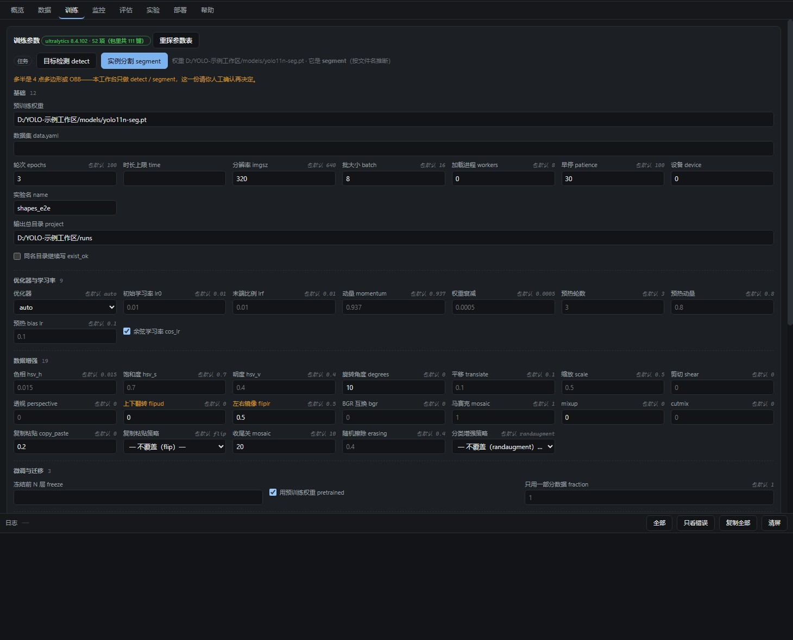

# YOLO 训练工作台 / YOLO Training Workbench

一个 **Uartix+ 代码插件（v3）**：把 YOLO 的「数据集拆分 → 训练 → 部署收口」三件事装进一个面板，
参数在面板里改，`python` 子进程由插件自己起，日志与进度实时拉回界面。

> 下面这张是**界面示意图**（用来说清信息分区），不是逐像素的真实截图；实际配色随 Uartix+ 主题走。

## 它是什么

- **一个面板**（`contributes.panels`）：环境自检、配置三层叠加、数据集扫描、训练实时进度与日志、训练记录（含每轮完成时间）、部署收口。
- **两条命令**（`contributes.commands`）：`yolo.status`（看现状）、`yolo.stop`（停止当前任务），
  在命令面板和 AI 里都能直接调，与面板按钮走同一批函数。
- 配置遵循**三层**：内置默认 ← 工作区 `config.yaml` 基准 ← 面板改动（只存与基准不同的那部分）。

## 装它

在 Uartix+ 里：**设置 → 插件管理 → 插件市场**，搜 `uartix.yolo`（话题 `topic:uartix-plugin`），点安装。
装进来是**停用态**；在插件管理里逐条看过并**批准权限**之后才能启用，批准卡会列出它要读写的目录与要起的程序。

也可以从本地目录装：把整个仓库目录放进 `<AppData>/plugins/` 之外任选一处，在插件管理里「从目录安装」。

## 用之前要做的一件事：登记路径

- **工作区根（`$WS`）**：在 **设置 → 插件管理 → 展开「YOLO 训练工作台」→ 目录绑定 → 工作区根** 里选择你的项目根目录。
  数据集、runs、logs、models，以及本插件生成的 `.uartix/` 状态目录都落在它下面（**写牢笼**只放行这几枚子目录）。
- **部署工具目录（`$EXT:deploy`）**：只有用到「部署」那一段才需要——在同一处「目录绑定」里给它选一个绝对路径。
  没绑时部署相关读数会照实显示「未绑定」，训练/数据集那几段不受影响（读缺绑定是降级，不是拒绝）。

## 权限（都在批准卡上逐条给你看）

| 类别 | 声明 | 实际约束 |
| --- | --- | --- |
| 读 | `$WS`、`$EXT:deploy` | 读是**知情**：Node 的精确读白名单在 Windows 上不生效，故读整盘放行、清单只告诉你它读了什么 |
| 写 | `$WS/.uartix` `$WS/datasets` `$WS/runs` `$WS/logs` `$WS/models` | 写是**牢笼**：内核级 `--allow-fs-write` 只放行这几枚目录，越界直接 `ERR_ACCESS_DENIED` |
| 进程 | `python` | 起子进程跑 ultralytics；停止走杀进程树（Windows 上只杀 node 会留孤儿吃满 GPU） |
| 界面 | `ui.panel` | 一块 iframe 面板（不透明源，碰不到宿主 DOM 与别的插件） |

## 依赖

本插件**自带** `main.mjs` + `panel.html`，不下载任何东西；但要真正跑训练，需要目标机器上有：

- Python + [`ultralytics`](https://github.com/ultralytics/ultralytics)（面板里那颗「深度自检」会报 torch/CUDA/ultralytics 版本）；
- 一个 YOLO 数据集（`images/` + `labels/` 结构，面板能扫描并按比例拆分）。

## 关于「桌宠 / 无边框」

没有单独的“桌宠”概念。透明无边框只是小部件（`contributes.widgets`）的一种表现形态；本插件不涉及小部件，只贡献面板与命令。

## 许可

MIT。见 [LICENSE](LICENSE)。

## 版本

`0.2.3` — 训练记录新增「完成时间」（取 `results.csv` 的最后写入时刻，悬停可看完整时间与用时）；修正部署页在部分主题下丢失描边与底色；窄窗口下的页头与表格改为可换行/横向滚动；目录绑定说明改到「设置 → 插件管理」。
